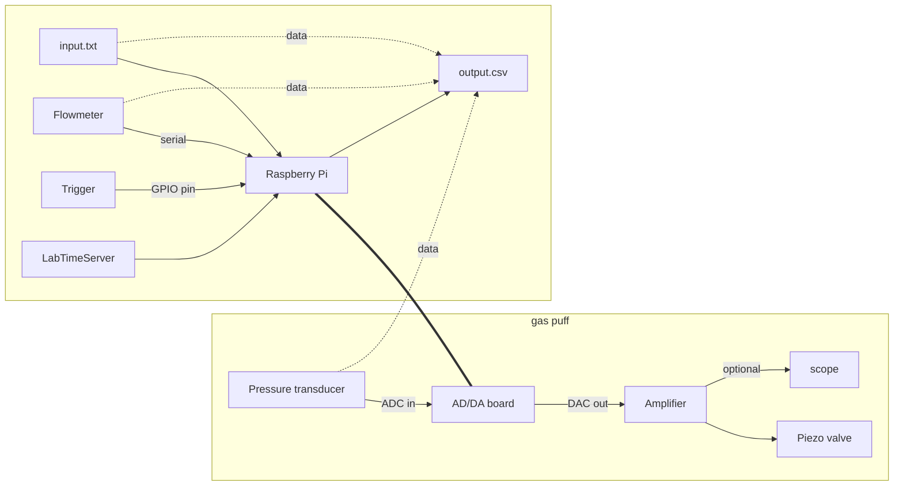

# bapsf_gaspuff

Monitoring of the gas-puff and pressure system of LAPD at the **Basic Plasma Science Facility (BAPSF)**. The repository covers two largely independent subsystems:

1. **Pfeiffer Vacuum gauge logging** — continuous pressure acquisition and real-time monitoring (see below).
2. **Gas-puff acquisition** — a Raspberry Pi pipeline tying together a Sensirion flow meter, a piezo valve driven through an AD/DA board, and a pressure transducer.

---

## Pfeiffer Vacuum Gauge

Everything for the Pfeiffer subsystem lives in [pfeiffer/](pfeiffer/). It talks to a **Pfeiffer Vacuum MaxiGauge TPG 366** controller over Ethernet, continuously logs every connected sensor's pressure to daily HDF5 files, and provides a live plotting GUI.

### Hardware & connection

- **Controller:** Pfeiffer MaxiGauge TPG 366 (up to 6 pressure sensors).
- **Transport:** TCP socket over Ethernet — default controller IP `192.168.7.44`, port `8000`.
- **Protocol:** Pfeiffer serial/ASCII mnemonic protocol (`PRX`, `TID`, `GAS`, etc.) with ACK/NAK handshaking, tunneled over the socket. Line termination is `CR+LF`.
- **Units:** Pressure logged in **Torr**.

### Files

| File | Purpose |
|------|---------|
| [pfeiffer/PfeifferVacuumCommunication.py](pfeiffer/PfeifferVacuumCommunication.py) | Low-level driver. Defines the `MaxiGauge` class (socket connect/disconnect, mnemonic send/enquire, ACK/NAK handling) and the `MaxiGaugeError` / `MaxiGaugeNAK` exceptions. |
| [pfeiffer/Pfeiffer_control.py](pfeiffer/Pfeiffer_control.py) | Acquisition loop. Continuously polls all sensors and appends readings to a daily HDF5 file. |
| [pfeiffer/Pfeiffer_GUI.py](pfeiffer/Pfeiffer_GUI.py) | PyQt5 real-time plotting GUI that reads the latest HDF5 file. |

### `MaxiGauge` driver (key methods)

- `connect()` / `disconnect()` — open/close the TCP socket (2 s timeout, up to 300 retries).
- `get_all_pressure_reading()` — returns `(status_list, pressure_list)` for all sensors via the `PRX` mnemonic, with retry on garbled responses.
- `get_device_id()` — sensor model IDs (`TID`).
- `get_gas_type()` — gas calibration setting per sensor (`GAS`), mapped through the `GAS_TYPE` table (Nitrogen, Argon, Hydrogen, Helium, Neon, Krypton, Xenon, CAL).
- `pressure(sensor)` — single-sensor reading (`PR<n>`), with status decoded via `PRESSURE_READING_STATUS` (e.g. *Underrange*, *Overrange*, *Sensor error/off*, *No sensor*).

### Acquisition: `Pfeiffer_control.py`

Run this to start logging:

```bash
cd pfeiffer
python Pfeiffer_control.py
```

What it does:

- Writes to `C:\data\gauge\pressure_data_<YYYY-MM-DD>.hdf5`, rolling over to a new file automatically at the day boundary.
- HDF5 layout: a `PfeifferVacuum` group containing one resizable dataset per sensor (`"1"`, `"2"`, …) plus a `timestamp` dataset (seconds since epoch). Each sensor dataset carries `Model`, `Gas`, `Unit`, and `Modified time` attributes; when a gauge or gas setting changes, the new value is appended to the relevant attribute list rather than overwritten.
- Uses **HDF5 SWMR (Single-Writer/Multiple-Reader)** mode so the GUI can read while the writer is running.
- **Resilience:** logs connection STARTED / LOST / RECOVERED events to `C:\data\gauge\connection_log.txt`, transparently reconnects on `MaxiGaugeError`/`TimeoutError`, and auto-recovers from stale SWMR locks by invoking `h5clear` (tries `h5clear` on `PATH`, then a vendored fallback path).

> **Configuration:** the controller IP, HDF5 output directory, and `h5clear` fallback path are set near the top of [pfeiffer/Pfeiffer_control.py](pfeiffer/Pfeiffer_control.py). Adjust them for your machine.

### Live monitoring: `Pfeiffer_GUI.py`

```bash
cd pfeiffer
python Pfeiffer_GUI.py
```

A PyQt5 window that opens the most recent HDF5 file in `C:\data\gauge` (SWMR read) and refreshes every 0.5 s in a background thread. It shows two stacked panels:

- **Top:** the last 30 seconds of pressure.
- **Bottom:** the full day binned into 5-minute averages.

The sensor to plot (`sensor_number`) and the rolling window length (`n_points`) are configurable at the top of the file.

### Dependencies (Pfeiffer)

`h5py`, `numpy`, `portalocker`, `PyQt5`, `matplotlib`, and the HDF5 `h5clear` command-line tool (bundled with the HDF Group HDF5 distribution).

### EPICS pressure monitor (in progress)

A Linux pressure monitor (EPICS IOC, SQLite store, live web page) is being built next to the logger above, which stays unchanged as the reference. Nothing of it has run against the real controller yet. So far:

| File | Purpose |
|------|---------|
| [pfeiffer/tpg366.py](pfeiffer/tpg366.py) | TPG 366 driver for the monitor: one connection kept open, read-only (`AYT`, `UNI`, `TID`, `GAS`, `CID`, `PRX`), pressures converted to Torr from the unit set on the controller, a status for every channel. Standard library only. |
| [pfeiffer/fake_tpg366.py](pfeiffer/fake_tpg366.py) | Fake controller (a small TCP server with made-up values) for tests and for running without the instrument: `python pfeiffer/fake_tpg366.py --port 8000`. |
| [pfeiffer/pressure_ioc.py](pfeiffer/pressure_ioc.py) | The IOC module. It reads the controller every 100 ms and publishes each reading as EPICS PVs. It runs inside the `diag_ioc` host of [bapsf_epics_core](https://github.com/BaPSF/bapsf_epics_core). |
| [pfeiffer/pressure_config.py](pfeiffer/pressure_config.py) | Checks the IOC module's options. A wrong value or a placeholder left in place stops the IOC at start and names the key. |
| [pfeiffer/pressure_gas.py](pfeiffer/pressure_gas.py) | The gas selection: the command that selects the gas in the machine, and the file it writes. |
| [pfeiffer/pressure_store.py](pfeiffer/pressure_store.py) | The store: its own process, which saves every reading the IOC publishes in one SQLite file per day. |
| [pfeiffer/pressure_db.py](pfeiffer/pressure_db.py) | The layout of the day files and the functions that read them (`read`, `read_minutes`, `stats`, `history`, `events`). Needs only `numpy`. |
| [pfeiffer/pressure_import.py](pfeiffer/pressure_import.py) | Copies the old logger's HDF5 files into the store's day files, once, so all pressure data is in one place. Needs `numpy` and `h5py`. |
| [pfeiffer/pressure_web.py](pfeiffer/pressure_web.py) | The page: its own process, which shows the readings live and the store's files as history, read-only. Its files are in [pfeiffer/pressure_web_static/](pfeiffer/pressure_web_static/). |
| [pfeiffer/deploy/systemd/](pfeiffer/deploy/systemd/) | Example systemd units: `diag-ioc@.service` (the IOC), `pressure-store.service`, `pressure-web.service`. Each lists its install steps. |
| [pfeiffer/deploy/nginx/](pfeiffer/deploy/nginx/) | Example nginx site, the one way in to the page from the lab network, and its systemd drop-in. |
| [pfeiffer/deploy/diag-ioc/](pfeiffer/deploy/diag-ioc/) | `pressure.toml.example`, the IOC's config with every key explained, and `readonly.acf`, which makes every PV read-only. |
| [pfeiffer/tests/](pfeiffer/tests/) | Tests against the fake controller: `python -m unittest discover -s pfeiffer/tests`. |

The controller accepts one network client, so the old logger and the new monitor cannot read it at the same time. The IOC is that one client; everything else reads PVs.

#### Running the IOC

```bash
python3 -m venv .venv
.venv/bin/pip install "bapsf-epics-core[ioc,clients] @ git+https://github.com/BaPSF/bapsf_epics_core.git@<tag>" -c pfeiffer/constraints.txt
cp pfeiffer/deploy/diag-ioc/pressure.toml.example pfeiffer/deploy/diag-ioc/readonly.acf <config directory>/
mv <config directory>/pressure.toml.example <config directory>/pressure.toml    # then replace every <...> placeholder
PYTHONPATH=pfeiffer .venv/bin/python -m diag_ioc --config <config directory>/pressure.toml
```

- The filled-in `pressure.toml` holds this machine's controller address, gauge names, limits and multipliers. It stays on the machine and is never committed.
- Without the instrument, start the fake controller and use `address = "127.0.0.1:8000"`.
- `bapsf_epics_core` has no tagged version yet; until it has, install it from a checkout (`pip install -e '<checkout>[ioc,clients]'`).

#### PVs

`<P>` is the module's prefix (`LAPD:MACH:PRESSURE`), `<S>` a source key (one controller, `TPG1`) and `<G>` a gauge key (`G1`, ...). All come from the config. Every PV is read-only.

| PV | Meaning |
|----|---------|
| `<P>:<G>:P` | Torr, `P_RAW` x `GAS_FACTOR`. Alarm when the status is not ok. |
| `<P>:<G>:P_RAW` | Torr, as the gauge sent it. |
| `<P>:<G>:GAS_FACTOR` | This gauge's multiplier for the selected gas. `<P>:<G>:GAS_FACTORS` holds its multiplier for every gas. |
| `<P>:<G>:STATUS` | 0 ok, 1 underrange, 2 overrange, 3 sensor error, 4 off, 5 no gauge, 6 identification error, 7 other, 8 no reply from the controller. |
| `<P>:<G>:RAW_STATUS` | The controller's own status code (-1 with status 8). |
| `<P>:<G>:BASE` | Torr, base pressure: the lowest 1-minute mean of `P_RAW` in the last `base_window_h` hours. Its alarm limits are the gauge's `base_warning_torr` (MINOR) and `base_alarm_torr` (MAJOR). Invalid until the window holds `base_ready_min` minutes; the window starts empty at every IOC start. |
| `<P>:<G>:NAME`, `SOURCE`, `CHANNEL` | From the config: where the gauge sits, and its controller and channel. |
| `<P>:<G>:MODEL`, `DEVICE_GAS`, `DEVICE_NAME` | As the controller reports them: gauge type, its own gas setting for the channel (MINOR alarm unless Nitrogen), the name stored in it. |
| `<P>:<S>:SAMPLE` | PVA group: one update per reading with `seq`, `time`, `gas`, `read_s` and for each gauge `<g>.p`, `<g>.p_raw`, `<g>.gas_factor`, `<g>.status`, `<g>.raw_status`, `<g>.base`. |
| `<P>:<S>:SAMPLE:SEQ`, `TIME`, `GAS` | Sample counter since IOC start, epoch seconds of the reading, the gas selected at that reading. |
| `<P>:<S>:CONNECTED`, `ERROR`, `READ_S`, `RECONNECTS` | The link to the controller: whether it answers, why the last read failed, how long a read takes, connections regained since IOC start. |
| `<P>:<S>:DRIVER`, `MODEL`, `SERIAL`, `FIRMWARE`, `UNIT`, `PERIOD_S` | The driver, what the controller reports about itself, the unit set on it, the read period. |
| `LAPD:MACH:GAS:SPECIES`, `SINCE`, `BY` | The selected gas, when it was selected (epoch seconds) and by which account. |
| `<P>:STAT:*`, `<P>:IOC:*` | Host health, as for every `diag_ioc` module. |

- Every record of one reading carries the reading's time as its timestamp, so a client can tell which values belong together.
- When the controller stops answering, one sample is published with every gauge INVALID and status 8, and the reason is in `<S>:ERROR`. The IOC then reconnects by itself, waiting 1 s at first and up to 30 s.
- The unit, gauge types, gas settings and names are read at every connect and once a minute. A unit changed on the front panel is therefore converted wrongly for up to a minute.

#### Selecting the gas

Which gas is in the machine is known only to a person. It is selected on the IOC's own machine:

```bash
python pfeiffer/pressure_gas.py --config /etc/diag-ioc/pressure.toml          # show the selection and the choices
python pfeiffer/pressure_gas.py --config /etc/diag-ioc/pressure.toml argon    # select a gas
```

- The command writes the species name to the config's `selection_file`. The IOC reads the file once a second and never writes it. Who may write that directory may select the gas.
- `SINCE` is the file's modification time and `BY` is its owner, so both come from the operating system.
- Until someone selects a gas, the selection is the config's `default`.
- The controller's own gas setting must stay on Nitrogen for every channel. Otherwise the reading is corrected twice.

#### The store

`pressure_store.py` saves every reading in `pressure_YYYYMMDD.sqlite`, one file per day in Los Angeles time. The files are the only record of the pressure. It is a separate process that only reads PVs, so trouble with the disk never reaches the IOC.

```bash
PYTHONPATH=pfeiffer .venv/bin/python pfeiffer/pressure_store.py --config <config directory>/pressure.toml --dir <store directory>
```

- `--config` is the IOC's own config file: the store takes the prefix, the source and the gauges from it. Restart the store after the file changes.
- It monitors the PVA group `<P>:<S>:SAMPLE` with `p4p`, so every reading arrives as one complete update, and commits once a second.
- Each row holds the reading as the gauge sent it (`p_raw`), the status, and the number of its row in the `setting` table: the gas and each gauge's multiplier. A change of gas adds a setting row and never rewrites a reading, so a wrong selection can be put right later.
- A jump in the IOC's sample counter is recorded as an event with the number of readings missed. Lost and regained connections, gauge status changes, gas changes and starts and stops are events too.
- If a commit fails (a full disk), the store tries again every second and keeps up to 10 minutes of readings in memory meanwhile.
- The store directory must be on a local disk. Six gauges at 10 readings a second are about 90 MB a day.
- A file that the store has closed (at the day change, or when it stops) is one plain file that any account can read and copy. The file being written has a `-wal` and a `-shm` file beside it: copy it with `sqlite3 <file> ".backup <copy>"`, not with `cp`.

Reading, from Python (`numpy` only), while the store is running or not:

```python
import pressure_db

r = pressure_db.read("<store directory>", start, end)          # every reading: r.time, r.pressure["G1"], r.status["G1"]
m = pressure_db.read_minutes("<store directory>", start, end)  # 1-minute summaries: m.time, m.min["G1"], m.mean["G1"], m.max["G1"]
s = pressure_db.stats("<store directory>", start, end, "G1")   # count, min, mean, max, first, last, change
```

- `start` and `end` are epoch seconds or aware `datetime` objects. A range may span days; a day without a file is skipped.
- Pressures are Torr, corrected for the gas (`P_RAW` x multiplier). `corrected=False` returns the gauge's own reading.
- The same data with the `sqlite3` command: `SELECT time, p_raw_g1, status_g1 FROM sample_tpg1 WHERE time >= <epoch s>`. The docstring of [pfeiffer/pressure_db.py](pfeiffer/pressure_db.py) lists every table.
- `BASE` and its limits use `P_RAW`, so a limit does not move when the selection changes.

#### Importing the old HDF5 files

`pressure_import.py` copies the `pressure_data_YYYY-MM-DD.hdf5` files of `Pfeiffer_control.py` into the day files, so the store's directory holds all the pressure data. It only reads the old files. It needs `h5py` (`.venv/bin/pip install h5py`).

```bash
PYTHONPATH=pfeiffer .venv/bin/python pfeiffer/pressure_import.py --config <config directory>/pressure.toml --dir <store directory> --check <old files or directory>
PYTHONPATH=pfeiffer .venv/bin/python pfeiffer/pressure_import.py --config <config directory>/pressure.toml --dir <store directory> <old files or directory>
```

- `--check` reads every file and reports what would be imported, without writing. The import then prints the same report.
- Each channel goes in under the gauge key the config gives that channel, so check that the config's channels match where the gauges were when the old files were written. A channel the config does not list, or that held no gauge, is left out and named in the report.
- The old files have no status, no gas selection and no unit check. Imported readings have status NULL (`read()` returns -1) and a setting row with species `not recorded` and multiplier 1, so their corrected pressure is the gauge's own reading. The controller's own gas setting of each channel goes into the `gauge` table as `device_gas`.
- A file whose gauge datasets differ in length from its timestamp dataset is not imported: a write failed part way, and the readings after it may not line up with their times. `--trim` imports such a file up to the length of the timestamp dataset when every gauge dataset is at least that long. That is what the old logger leaves when a gauge or gas setting changed.
- Each day file written gets an `import` event naming the old file. Running the import again skips the days that already have it. Today's day file is not written, because the store may be writing it.

#### The page

`pressure_web.py` serves the page at `http://127.0.0.1:8081/`; on the machine, nginx passes it on at `http://<lab address>/diagnostic/pressure/`.

```bash
.venv/bin/pip install fastapi uvicorn websockets -c pfeiffer/constraints.txt
PYTHONPATH=pfeiffer .venv/bin/python pfeiffer/pressure_web.py --config <config directory>/pressure.toml --dir <store directory>
```

- One tile per gauge: the pressure corrected for the gas, the gauge's own reading and its multiplier, its status and type, and its base pressure against its limits. A tile and a bar at the top turn yellow above the warning limit and red above the alarm limit.
- The gas row shows the selected gas, since when and by whom. It only shows the selection; the gas is selected on the IOC's machine (above).
- The live chart holds every reading of the last 5 minutes. The history chart reads the store's files (`pressure_db.history()`) over 1 hour to 30 days, corrected for the gas or as the gauges read; the base-pressure limits are drawn on the gauge reading, since that is what they are compared with.
- Bars say when the controller does not answer, when the IOC cannot be reached, and when readings stop.
- It takes the gauges, limits and multipliers from the IOC's config (`--config`): restart it after that file changes. It never shows the controller's address.
- It writes nothing: no PV, no file. It monitors the PVA group and a few single PVs with `p4p`, and opens the day files read-only.
- Limits, as on the interferometer page: 20 viewers in all, 3 pages per address, history requests rate-limited per address. A page that loses its connection says so and is reloaded by hand.
- `PRESSURE_WEB_HOST` and `PRESSURE_WEB_PORT` change where it listens; nginx's `proxy_pass` must match.

#### Tests

```bash
python -m unittest discover -s pfeiffer/tests
```

- The driver, options and gas selection tests need nothing but Python 3.11 or later.
- The IOC module tests need `bapsf_epics_core`. Those that start a real IOC also need `softioc` and `pyepics`. They are skipped where a package is missing.
- The page tests also need `fastapi`, `uvicorn` and `websockets`, and `node` for the page's connection script. They hand the page made-up PV updates, or those the IOC module publishes while reading the fake controller.
- Nothing here has been run against the real controller.

---

## Gas-Puff Acquisition (overview)

The gas-puff side runs on a Raspberry Pi and coordinates the valve, flow meter, and pressure transducer. The data flow:



- **Flow meter:** Sensirion SFC5xxx, accessed over the SHDLC serial protocol. Driver docs: <https://sensirion.github.io/python-shdlc-sfc5xxx/index.html>
- **Trigger:** hardware shot trigger read on a Raspberry Pi GPIO pin (via a small C library, `gpio_detect.so`).
- **Output:** per-shot flow data saved to HDF5.

Arduino firmware for the trigger/status display lives in [arduino_src/](arduino_src/), and hardware datasheets (AD/DA board, amplifiers, Arduino) are in [doc/](doc/).

---

## Repository layout (`src/`)

The [src/](src/) directory holds the gas-puff Raspberry Pi code. It is a separate pipeline from the Pfeiffer logger above.

| File | Role |
|------|------|
| [src/flowmeter_main.py](src/flowmeter_main.py) | Main acquisition entry point — GPIO trigger handling, multiprocessing-based flow capture, and per-shot HDF5 saving. |
| [src/FlowMeterCommunication.py](src/FlowMeterCommunication.py) | `FlowMeter` wrapper around the Sensirion `sensirion-shdlc-sfc5xxx` driver. |
| [src/wavegen_control.py](src/wavegen_control.py) | Driver for the waveform generator / AD/DA board used to drive the piezo valve. |
| [src/kernel.py](src/kernel.py) | High-level `GasPuffValve` interface coupling the valve, trigger, and waveform output. |
| [src/input.py](src/input.py) | Waveform definition (`generate_pulse_waveform`) and a small Tkinter control panel. |
| [src/main.py](src/main.py) | Standalone example that programs and bursts a pulse waveform. |

> Note: some wavegen-coupled paths are partially archived/commented; `flowmeter_main.py` is the current acquisition driver.

---

## License

See [LICENSE](LICENSE).
